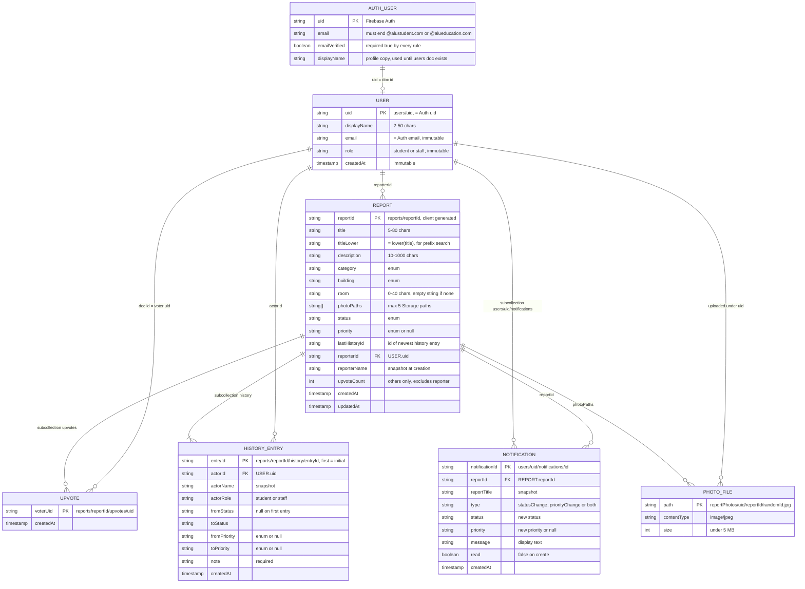

# Campus Incident Reporting App — Database Design

Oct 27, 2026 · Companion to `docs/Hero Specs.md` (section 6 and 8 are superseded by this document)

Firebase Authentication, Cloud Firestore (Native mode) and Cloud Storage. This design is final: it
is
created once before development starts and is not expected to change. Every decision below was
agreed in the design interview; deviations from the spec are listed in section 12.

Deployable artifacts (repo root):

| File                     | Purpose                                           |
|--------------------------|---------------------------------------------------|
| `firestore.rules`        | Complete Firestore security rules                 |
| `storage.rules`          | Complete Storage security rules                   |
| `firestore.indexes.json` | Every composite index the app's queries need (23) |

---

## 1. Conventions

- Field names are camelCase. Enum values are stable string keys; display labels live in the app.
- Document IDs are Firebase auto-IDs unless stated. The client generates them (`doc().id`) so a
  document can be referenced before it is written.
- All timestamps are Firestore `timestamp`. The rules require `createdAt` / `updatedAt` to equal
  `request.time`, so write them with `FieldValue.serverTimestamp()`.
- Optional values are stored as explicit `null` (or `""` for `room`), never omitted, so every
  document of a type has the same keys and the rules can enforce the exact key set.
- No Cloud Functions. All integrity (counters, history, notifications) is enforced by the rules
  using batched writes and `getAfter()` / `existsAfter()`.
- The Firestore database id is `(default)`.

## 2. Enumerations

| Enum                | Allowed values (exact keys)                                                             |
|---------------------|-----------------------------------------------------------------------------------------|
| `role`              | `student`, `staff`                                                                      |
| `category`          | `facilities`, `water`, `electricity`, `furniture`, `sanitation`, `safety`               |
| `building`          | `learningCommons`, `enterpriseCommons`, `socialCommons`, `parking`, `garden`, `hostels` |
| `status`            | `submitted`, `inProgress`, `resolved`, `rejected`                                       |
| `priority`          | `low`, `medium`, `high`, `urgent` (or `null` until staff set one)                       |
| notification `type` | `statusChange`, `priorityChange`, `both`                                                |

Display labels (not stored): Facilities, Water shortage, Electricity outage, Damaged furniture,
Sanitation, Safety · Learning Commons, Enterprise Commons, Social Commons, Parking, Garden,
Hostels ·
Submitted, In Progress, Resolved, Rejected · Low, Medium, High, Urgent.

The rules hard-code these lists. Adding a category or building later means editing
`firestore.rules` and redeploying (no data migration).

## 3. Entity-relationship diagram

Firestore has no tables or foreign keys. Entities below are collections (or subcollections);
relationships are reference fields or parent/child nesting. `FK` marks a reference by id that is
enforced by the security rules, not by the database.



### Firestore tree

```
users/{uid}
  └─ notifications/{notificationId}
reports/{reportId}
  ├─ upvotes/{uid}
  └─ history/{entryId}            first entry has id "initial"
```

### Storage tree

```
reportPhotos/{reporterUid}/{reportId}/{randomId}.jpg
```

## 4. Collection reference

### 4.1 `users/{uid}`

| Field       | Type      | Required | Constraints                                                        |
|-------------|-----------|----------|--------------------------------------------------------------------|
| displayName | string    | yes      | 2–50 chars. Only field a user can edit (students only)             |
| email       | string    | yes      | Equals `request.auth.token.email`; immutable                       |
| role        | string    | yes      | `student` or `staff`; immutable; clients can only create `student` |
| createdAt   | timestamp | yes      | `request.time`; immutable                                          |

- Doc id is the Auth uid. Exactly these 4 keys.
- Created by the client on the **first verified sign-in** (rules need `email_verified == true`).
  Until it exists the app stays on the verification screen. Registration stores the name in the
  Auth profile (`updateDisplayName`) and the app copies it here.
- Staff docs are created by you in the Console (see section 10); clients cannot create or change
  `role: "staff"`.
- Never deleted.

### 4.2 `reports/{reportId}`

| Field         | Type           | Required | Constraints                                                                       |
|---------------|----------------|----------|-----------------------------------------------------------------------------------|
| title         | string         | yes      | 5–80 chars; client trims                                                          |
| titleLower    | string         | yes      | Must equal `title.lower()`                                                        |
| description   | string         | yes      | 10–1000 chars                                                                     |
| category      | string         | yes      | enum                                                                              |
| building      | string         | yes      | enum                                                                              |
| room          | string         | yes      | 0–40 chars; `""` when not provided                                                |
| photoPaths    | list of string | yes      | ≤ 5 entries; Storage object paths (not URLs); `[]` if none                        |
| status        | string         | yes      | enum; `submitted` on create                                                       |
| priority      | string \| null | yes      | enum or `null`; `null` on create; staff-set                                       |
| lastHistoryId | string         | yes      | Id of the newest `history` doc; `"initial"` on create                             |
| reporterId    | string         | yes      | Auth uid of the creator; immutable                                                |
| reporterName  | string         | yes      | Must equal the creator's `users.displayName` at creation; immutable snapshot      |
| upvoteCount   | number (int)   | yes      | 0 on create; changed only ±1 with the matching vote doc; excludes the reporter    |
| createdAt     | timestamp      | yes      | `request.time`; immutable                                                         |
| updatedAt     | timestamp      | yes      | `request.time` on create, student edit and staff update; **not** touched by votes |

Exactly these 15 keys. Who can change what after creation:

| Actor                             | Writable fields                                                                 |
|-----------------------------------|---------------------------------------------------------------------------------|
| Owner student, status `submitted` | title, titleLower, description, category, building, room, photoPaths, updatedAt |
| Staff                             | status, priority, lastHistoryId, updatedAt (and must change status or priority) |
| Any other student (vote)          | upvoteCount only (±1, tied to the `upvotes/{uid}` doc)                          |

### 4.3 `reports/{reportId}/upvotes/{uid}`

| Field     | Type      | Notes                        |
|-----------|-----------|------------------------------|
| createdAt | timestamp | `request.time`; the only key |

Doc id is the voter's uid, so "one vote per student per report" is structural. Existence means
the user voted. The reporter can never create one on their own report.

### 4.4 `reports/{reportId}/history/{entryId}`

Append-only audit trail. Never updated.

| Field        | Type           | Constraints                                                     |
|--------------|----------------|-----------------------------------------------------------------|
| actorId      | string         | Auth uid of the writer                                          |
| actorName    | string         | Snapshot of the writer's `displayName`                          |
| actorRole    | string         | `student` (initial entry) or `staff`                            |
| fromStatus   | string \| null | Report status before the change; `null` on the initial entry    |
| toStatus     | string         | Report status after the change                                  |
| fromPriority | string \| null | Priority before                                                 |
| toPriority   | string \| null | Priority after                                                  |
| note         | string         | Initial entry: `"Report submitted"`. Staff entries: 3–300 chars |
| createdAt    | timestamp      | `request.time`                                                  |

- **Initial entry**: id `initial`, written by the student in the same batch as the report.
- **Staff entry**: auto-id, written in the same batch as the report update; the report's
  `lastHistoryId` must equal this id, `from*` must equal the report's values before the batch and
  `to*` its values after. Student edits are not logged.
- Deleted only as part of the owner deleting the whole report (section 6, W4).

### 4.5 `users/{uid}/notifications/{notificationId}`

For the reporter only. Staff never receive notifications.

| Field       | Type           | Constraints                                                                  |
|-------------|----------------|------------------------------------------------------------------------------|
| reportId    | string         | The report that changed                                                      |
| reportTitle | string         | Must equal the report's title                                                |
| type        | string         | `statusChange`, `priorityChange` or `both`; must match what actually changed |
| status      | string         | The report's new status                                                      |
| priority    | string \| null | The report's new priority                                                    |
| message     | string         | 1–200 chars, display text e.g. "Your report moved to In Progress"            |
| read        | boolean        | `false` on create; the recipient can only flip it to `true`                  |
| createdAt   | timestamp      | `request.time`                                                               |

One notification per staff update (even if both status and priority changed). The recipient may
delete their own notifications (used when they delete a report).

### 4.6 Storage: `reportPhotos/{reporterUid}/{reportId}/{randomId}.jpg`

| Property     | Rule                                                                                                                                                                  |
|--------------|-----------------------------------------------------------------------------------------------------------------------------------------------------------------------|
| Path         | `reporterUid` is the uploader; `randomId` is 8–64 chars of `A-Za-z0-9_-`                                                                                              |
| Content type | `image/jpeg` only (the app re-encodes everything to JPEG while compressing)                                                                                           |
| Size         | `< 5 MB`                                                                                                                                                              |
| Read         | Any verified `@alustudent.com` / `@alueducation.com` user                                                                                                             |
| Create       | The student named in the path, if the report does not exist yet (new report, or an upload left over from a failed submit) **or** exists, is theirs and is `submitted` |
| Update       | Never. Files are immutable; replacing a photo means a new `randomId`                                                                                                  |
| Delete       | Same condition as create                                                                                                                                              |

`photoPaths` on the report is the source of truth. The app resolves a path to a URL at read time
(`getDownloadURL`), so no tokens are stored.

## 5. Access control matrix (as enforced by the rules)

| Operation                               | Student                                        | Staff                                         |
|-----------------------------------------|------------------------------------------------|-----------------------------------------------|
| Create own `users` doc                  | Yes (verified, student domain, role `student`) | No (Console only)                             |
| Read own `users` doc                    | Yes                                            | Yes                                           |
| Read others' `users` doc                | No                                             | Yes                                           |
| Edit own `displayName`                  | Yes                                            | No                                            |
| Read any report / history / upvotes     | Yes                                            | Yes                                           |
| Create report (+ initial history)       | Yes, own, single batch                         | No                                            |
| Edit report content                     | Own, only while `submitted`                    | No                                            |
| Delete report (+ subdocs, photos)       | Own, only while `submitted`, single batch      | No                                            |
| Vote / un-vote                          | Others' reports only                           | No                                            |
| Change status or priority               | No                                             | Yes, with history + notification in one batch |
| Read / mark-read / delete notifications | Own                                            | No                                            |
| Create notification                     | No                                             | Only as part of a status/priority update      |
| Upload / delete photos                  | Own, per the Storage condition above           | No                                            |

## 6. Write operations (each is one atomic batch unless noted)

| #  | Operation                    | Client steps                                                                                                                                                                                                                                                                                                                                      |
|----|------------------------------|---------------------------------------------------------------------------------------------------------------------------------------------------------------------------------------------------------------------------------------------------------------------------------------------------------------------------------------------------|
| W1 | First verified sign-in       | Read `users/{uid}`; if missing, `set` it with the 4 fields (`role: "student"`, name from Auth profile).                                                                                                                                                                                                                                           |
| W2 | Create report                | Generate `reportId`. Upload each photo to `reportPhotos/{uid}/{reportId}/{randomId}.jpg`. Then **one batch**: `set reports/{reportId}` (status `submitted`, priority `null`, `upvoteCount` 0, `lastHistoryId: "initial"`, `reporterName` from `users`) + `set reports/{reportId}/history/initial`. If the batch fails, delete the uploaded files. |
| W3 | Edit report                  | Upload any new photos, `update` the report (editable fields + `updatedAt`), then delete removed files from Storage. Only while `submitted`.                                                                                                                                                                                                       |
| W4 | Delete report                | Read the report's `history`, `upvotes` and the owner's `notifications where reportId == id`. **One batch** deletes the report, all those docs. Then delete the photo files in Storage. Only while `submitted`.                                                                                                                                    |
| W5 | Staff status/priority update | Generate `historyId` and `notificationId`. **One batch**: `update reports/{id}` (`status`, `priority`, `updatedAt`, `lastHistoryId = historyId`) + `set reports/{id}/history/{historyId}` + `set users/{reporterId}/notifications/{notificationId}`. At least one of status/priority must change; note is mandatory.                              |
| W6 | Vote on                      | **One batch**: `set reports/{id}/upvotes/{uid}` + `update reports/{id}.upvoteCount += 1`.                                                                                                                                                                                                                                                         |
| W6 | Vote off                     | **One batch**: `delete reports/{id}/upvotes/{uid}` + `update reports/{id}.upvoteCount -= 1`. Use `FieldValue.increment(±1)`.                                                                                                                                                                                                                      |
| W7 | Mark notification read       | `update users/{uid}/notifications/{id}` with `{read: true}`.                                                                                                                                                                                                                                                                                      |
| W8 | Rename self                  | `update users/{uid}` with `{displayName}`. Old reports keep the old `reporterName` (snapshot).                                                                                                                                                                                                                                                    |

## 7. Queries and indexes

All indexes are in `firestore.indexes.json` (23 composites). Single-field indexes are automatic.

| Query                      | Filters                                                                                    | Order                                  | Index used                                                                  |
|----------------------------|--------------------------------------------------------------------------------------------|----------------------------------------|-----------------------------------------------------------------------------|
| Home feed                  | optional `status ==`, `category ==`; optional date range on `createdAt`                    | `createdAt desc`                       | `status+createdAt`, `category+createdAt`, `status+category+createdAt`       |
| Home feed, sorted by votes | optional `status ==`, `category ==`                                                        | `upvoteCount desc`                     | `status+upvoteCount`, `category+upvoteCount`, `status+category+upvoteCount` |
| Staff "Needs action"       | `status in [submitted, inProgress]` plus the optional ones above                           | same                                   | same as above (`in` reuses the `status` indexes)                            |
| My reports                 | `reporterId ==` plus optional `status`, `category`, date range                             | `createdAt desc` or `upvoteCount desc` | 8 `reporterId+…` indexes                                                    |
| Title search               | `titleLower >= q and < q+''` plus optional equality on `status`, `category`, `reporterId` | `titleLower`                           | 7 `…+titleLower` indexes                                                    |
| Similar-report hint        | `category ==`, `building ==`, `status in [submitted, inProgress]`                          | `createdAt desc`                       | `category+building+status+createdAt`                                        |
| Unread notifications list  | `read == false`                                                                            | `createdAt desc`                       | `read+createdAt` (collection `notifications`)                               |
| Bell badge                 | `read == false`                                                                            | `count()`                              | single-field                                                                |
| Staff status counters      | `status ==`                                                                                | `count()`                              | single-field. One aggregate query per status, no stats doc                  |
| Report detail              | doc get; `history` ordered `createdAt` asc                                                 |                                        | single-field                                                                |
| Vote state                 | `get reports/{id}/upvotes/{uid}`                                                           |                                        | none                                                                        |

Firestore limits that shape the query plan:

- A range on `createdAt` forces `orderBy createdAt` first. So **date range + vote sort** cannot
  both run on the server: sort by votes, apply the date range client-side (or vice versa).
- Title prefix search is a range on `titleLower`, so **title search + date range** cannot both run
  on the server: apply the date range client-side while a search term is active.

## 8. Security rules summary

Full text is in `firestore.rules` and `storage.rules`. Enforced in addition to the matrix:

- Every request needs `email_verified == true` and a token email on one of the two ALU domains.
  Student actions also require the email to be `@alustudent.com` and
  `users/{uid}.role == 'student'`;
  staff actions require `@alueducation.com` and `role == 'staff'`.
- Exact key sets and types on every create; enum, length and timestamp checks.
- Vote counter: `upvoteCount` changes by exactly +1 when the vote doc is created in the same batch
  and -1 when it is deleted in the same batch; never on your own report.
- Staff report update must be accompanied by a history entry whose id is stored in
  `lastHistoryId`, whose from/to values match the report's before/after, plus a correctly typed
  notification for the reporter.
- Student history writes: only the `initial` entry, only while creating the report.
- `users`: `role`, `email`, `createdAt` immutable; only `displayName` editable, students only.

### Rules Playground test cases

| #  | Case                                                                  | Expected |
|----|-----------------------------------------------------------------------|----------|
| 1  | Unverified user reads `reports`                                       | Deny     |
| 2  | `@gmail.com` verified user reads `reports`                            | Deny     |
| 3  | Student creates `users/{uid}` with `role: "staff"`                    | Deny     |
| 4  | Student creates report with `upvoteCount: 3` / `status: "inProgress"` | Deny     |
| 5  | Student creates report without the `history/initial` doc in the batch | Deny     |
| 6  | Student edits own report while `submitted` (allowed fields)           | Allow    |
| 7  | Student edits own report after status is `inProgress`                 | Deny     |
| 8  | Student edits another student's report                                | Deny     |
| 9  | Student changes `status` or `priority`                                | Deny     |
| 10 | Student votes on own report                                           | Deny     |
| 11 | Student votes without the vote doc / changes count by 2               | Deny     |
| 12 | Student votes twice (second create)                                   | Deny     |
| 13 | Staff updates status with matching history + notification batch       | Allow    |
| 14 | Staff updates status without a note / without history                 | Deny     |
| 15 | Staff updates `title` or deletes a report                             | Deny     |
| 16 | Staff creates a notification not tied to a report change              | Deny     |
| 17 | Student marks own notification read                                   | Allow    |
| 18 | Student reads another user's notification                             | Deny     |
| 19 | Student deletes own `submitted` report with its subdocs (one batch)   | Allow    |
| 20 | Same, after status is `resolved`                                      | Deny     |
| 21 | Student updates or deletes a history entry alone                      | Deny     |
| 22 | Upload 6 MB / `image/png` / to another user's path (Storage)          | Deny     |
| 23 | Upload to own path for a report that is no longer `submitted`         | Deny     |

## 9. Authentication

| Item              | Design                                                                                                                                                        |
|-------------------|---------------------------------------------------------------------------------------------------------------------------------------------------------------|
| Provider          | Email/Password enabled; no other providers                                                                                                                    |
| Registration      | Student form accepts `@alustudent.com` only; sets Auth display name; sends verification email                                                                 |
| Staff             | Pre-created in the Console, `@alueducation.com`; they are never registered through the app                                                                    |
| Verification gate | App stays on the verify screen until `emailVerified` is true and `users/{uid}` exists (created by W1 for students)                                            |
| Role source       | Only `users/{uid}.role` in Firestore. No custom claims, no client-supplied role                                                                               |
| Password rules    | Min 8 chars with a letter and a number are enforced in the app; Firebase Auth itself only enforces its own minimum, so the rules do not and cannot check this |
| Password reset    | Firebase `sendPasswordResetEmail`; no Firestore involvement                                                                                                   |
| Session           | Firebase default persistence; logout returns to Login                                                                                                         |

## 10. Setup checklist and staff runbook

**One-time project setup**

1. Create the Firebase project and register the Android app (FlutterFire).
2. Authentication → enable Email/Password. Review the email-verification and password-reset
   templates.
3. Firestore → create the `(default)` database in **Native mode**, in the location chosen below.
4. Storage → create the default bucket in the same location.
5. `firebase.json` (create at repo root when initialising the Firebase CLI):
   ```json
   {
     "firestore": { "rules": "firestore.rules", "indexes": "firestore.indexes.json" },
     "storage": { "rules": "storage.rules" }
   }
   ```
6. `firebase deploy --only firestore:rules,firestore:indexes,storage`. The CLI grants the
   cross-service access that lets Storage rules read Firestore. Wait for the indexes to finish
   building.
7. Run the Rules Playground cases in section 8 before the demo.

**Staff onboarding (repeat per staff member)**

1. Authentication → Add user: `name@alueducation.com` + temporary password. Copy the uid.
2. Firestore → `users/{uid}` with fields `displayName` (string), `email` (string, identical to
   the Auth email), `role` = `staff` (string), `createdAt` (timestamp).
3. The staff member signs in once and verifies through the emailed link (Console-created users
   start unverified, and the rules reject unverified users).

**Region (open item)**: Firestore and Storage locations cannot be changed after creation. Planned:
`africa-south1` for both, for the Kigali campus. **Verify availability for both products before
creating them** and pick the closest supported region if it is not available.

## 11. Known limitations (accepted)

- The rules cannot loop over `photoPaths`, so they do not verify each path belongs to the reporter.
  Storage rules still stop anyone uploading to another user's path, so the worst case is a broken
  image on one's own report.
- The 5-photo cap is enforced on `photoPaths` only; Storage cannot count files. Orphan uploads from
  an abandoned form are possible and only deletable by their uploader.
- Report delete runs as a single batch (500 operation limit): a report with roughly 490+ votes
  would leave some vote docs behind. Not realistic at campus scale.
- Vote and notification races are resolved by the batch preconditions; a losing client sees a
  permission error and should refresh.
- No App Check. Adding it later is a configuration change and does not alter the schema.
- Rules use up to a handful of `get()` calls per operation (user role, report); well under the
  Firestore limits for batched writes.
- Staff accounts cannot change their own display name through the app.

## 12. Differences from `Hero Specs.md` section 6/8

| Spec                                                             | This design                                                                             | Reason                                                                                              |
|------------------------------------------------------------------|-----------------------------------------------------------------------------------------|-----------------------------------------------------------------------------------------------------|
| `photoUrls` (download URLs)                                      | `photoPaths` (Storage paths)                                                            | URLs carry tokens and break if moved                                                                |
| Storage `reports/{reportId}/{index}.jpg`                         | `reportPhotos/{uid}/{reportId}/{randomId}.jpg`                                          | Report does not exist at upload time, so ownership comes from the path; index names collide on edit |
| Reporter counted in `upvoteCount` / rule says `== 0`             | Count excludes the reporter                                                             | The two statements contradicted                                                                     |
| History: `staffId`, `staffName`, `status`, `priority`            | `actorId/Name/Role`, `from/toStatus`, `from/toPriority`                                 | Initial entry is written by a student; before/after is needed for validation                        |
| —                                                                | `titleLower` on reports                                                                 | Server-side prefix search                                                                           |
| —                                                                | `lastHistoryId` on reports                                                              | Lets the rules guarantee every staff change has a history entry                                     |
| Notification `{reportId, reportTitle, message, read, createdAt}` | Adds `type`, `status`, `priority`                                                       | Status and priority changes are distinguishable and verifiable                                      |
| `room` optional                                                  | Always present, `""` when empty                                                         | Fixed key set                                                                                       |
| Rules deny history delete                                        | Owner may delete history, votes, notifications as part of deleting a `submitted` report | Hard delete must not leave orphans                                                                  |
| 2 indexes                                                        | 23 indexes                                                                              | All filter, sort and search combinations supported on the server                                    |
| `users` doc created at registration                              | Created at first verified sign-in                                                       | Rules require a verified email for every write                                                      |
| Region unspecified                                               | `africa-south1` planned, to verify                                                      | Location is permanent                                                                               |
