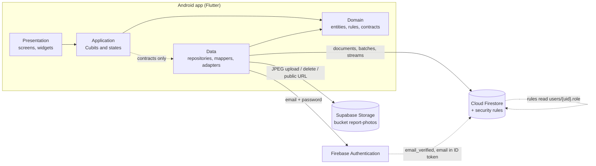
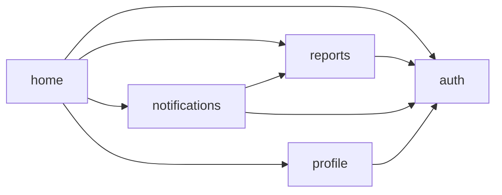
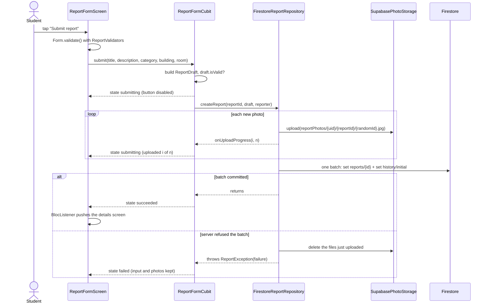
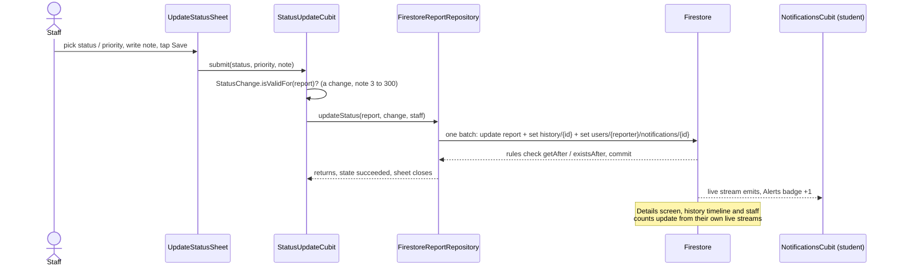
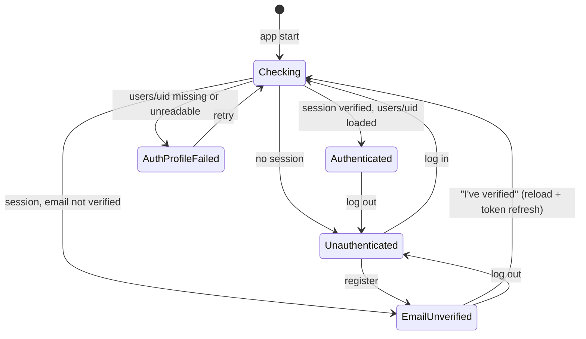

# Campus Incident Reporting App — Technical Documentation

Nov 1, 2026 · Companion to `docs/Hero Specs.md` (what to build) and `docs/Hero Database Design.md`
(the data model, which is authoritative for data). This document describes what was **built**: how
the code is organised, how data and state flow through it, how it is secured, and how it was tested.
Where it differs from the Specs, section 17 lists the deviation and the reason.

Source of truth for each topic:

| Topic                  | Where                                                                 |
|------------------------|-----------------------------------------------------------------------|
| Features and flows     | `docs/Hero Specs.md` sections 3 to 5                                  |
| Collections, fields    | `docs/Hero Database Design.md` sections 2 to 4                        |
| Write batches W1 to W8 | `docs/Hero Database Design.md` section 6, mapped to code in section 8 |
| Security rules         | `firestore.rules`, summarised in section 10                           |
| Code structure rules   | `docs/code-conventions/`, summarised in sections 4 and 5              |
| Manual test checklist  | `docs/Hero Test Checklist.md`                                         |
| Decisions              | `docs/adr/`                                                           |

---

## 1. Overview

Hero is a Flutter (Android only) app where ALU students report campus problems and campus staff
triage them through to resolution. It has two roles and one report lifecycle:

```
Submitted ⇄ In Progress ⇄ Resolved        (staff move a report in any direction)
     └────────── Rejected ──────────┘
```

| Capability                               | Student                 | Staff                             |
|------------------------------------------|-------------------------|-----------------------------------|
| Register, verify email, log in, reset    | Yes (`@alustudent.com`) | Log in only (`@alueducation.com`) |
| File a report with up to 5 photos        | Yes                     | No                                |
| Browse, search, filter, sort all reports | Yes                     | Yes                               |
| Edit or delete own report                | Only while Submitted    | No                                |
| "Me too" vote on someone else's report   | Yes                     | No                                |
| Change status and priority, with a note  | No                      | Yes                               |
| See the status history of a report       | Yes                     | Yes                               |
| In-app notifications on status changes   | Yes                     | No                                |
| Status counts and "Needs action" list    | No                      | Yes                               |
| Change own display name                  | Yes                     | No                                |

Everything is enforced twice: the UI hides what a role may not do, and the Firestore rules refuse
it (section 10). The rules are the real gate.

## 2. System architecture



Two backends, split on purpose:

| Backend          | Used for                                      | Why                                                     |
|------------------|-----------------------------------------------|---------------------------------------------------------|
| Firebase Auth    | Identity, email verification, password reset  | Assignment requirement                                  |
| Cloud Firestore  | Users, reports, history, votes, notifications | Assignment requirement; live streams; rules as the gate |
| Supabase Storage | Report photos only                            | Firebase Storage needs the paid plan (ADR 0001)         |

There are no Cloud Functions. Counters, history and notifications are kept consistent by batched
writes that the security rules validate with `getAfter()` and `existsAfter()` (ADR 0003).

## 3. Technology stack

| Concern           | Choice                                             | Notes                                                        |
|-------------------|----------------------------------------------------|--------------------------------------------------------------|
| Framework         | Flutter 3 / Dart 3 (`sdk: ^3.13.3`), Android       | Material 3, Pixel 8 emulator                                 |
| State management  | `flutter_bloc` 9 (Cubit), `equatable`              | One Cubit per screen or feature, sealed states (ADR 0002)    |
| Identity          | `firebase_auth` 7                                  | Email and password only                                      |
| Database          | `cloud_firestore` 7                                | Native mode, `(default)` database                            |
| Photo storage     | `supabase_flutter` 2                               | Anon key, policies limited to the `reportPhotos/` prefix     |
| Photo capture     | `image_picker`, `flutter_image_compress`           | Camera and gallery, re-encoded as JPEG                       |
| Formatting, fonts | `intl`, `google_fonts` (DM Sans)                   | Relative and absolute dates                                  |
| Configuration     | `flutter_dotenv`                                   | `.env` bundled as an asset, read through `lib/core/env.dart` |
| Tests             | `flutter_test`, `bloc_test`                        | Hand-written fakes instead of mocks                          |
| Rules tests       | `@firebase/rules-unit-testing`, Firestore emulator | `scripts/rules-tests/`                                       |
| Navigation        | Plain `Navigator.push` behind an auth gate         | No router package                                            |
| Models            | Hand-written, `fromMap` / `toMap`                  | No code generation                                           |

## 4. Project structure

Feature-first. Each feature has its own `domain`, `application`, `data` and `presentation` folders
and one barrel file that is its public API.

```
lib/
  main.dart                      Initialisation only: dotenv, Firebase, Supabase, wiring
  app.dart                       Composition root: repository providers, MaterialApp, AuthGate
  firebase_options.dart          Generated by FlutterFire
  core/
    constants.dart               Email domains
    env.dart                     Typed access to .env (fails fast when a key is missing)
    theme/                       Colors, spacing, radii, ThemeData (green #1E8E5A on cream #F7F4EE)
  shared/widgets/                Generic widgets: AppButton, AppTextField, AppDropdownField,
                                 EmptyState, ErrorView, ErrorBanner, PasswordField, HeroLogo
  features/
    auth/          28 files      Register, verify, login, reset, session, role, rename (W1, W8),
                                 switching between accounts on the device
    reports/       67 files      Reports, photos, history, votes, status updates (W2 to W6)
    notifications/ 12 files      Student alerts and the unread badge (W7)
    profile/        4 files      Profile screen and display name change
    home/           2 files      Role-based bottom navigation shell
test/                            Mirrors lib/ (24 test files)
scripts/
  seed-staff.js                  Creates a staff user's verified flag and users/{uid} document
  rules-tests/                   Firestore rules tests on the emulator
firestore.rules                  Complete security rules
firestore.indexes.json           The 23 composite indexes
```

## 5. Layering and dependency rules

Dependencies point inward: `presentation → application → domain`, and `data → domain`.

| Layer          | Contains                                                          | May import                        |
|----------------|-------------------------------------------------------------------|-----------------------------------|
| `domain`       | Entities, enums, validators, business rules, repository contracts | Dart core only                    |
| `application`  | Cubits and their states                                           | `domain`                          |
| `data`         | Repository implementations, mappers, SDK adapters                 | `domain`, Firebase, Supabase      |
| `presentation` | Screens and widgets                                               | `application`, `domain`, `shared` |

Rules that keep this honest, all checked by `test/architecture_test.dart`:

- `domain` imports no Flutter and no SDK.
- `application` imports no SDK and no `package:flutter/material.dart`.
- `presentation` never imports `cloud_firestore`, `firebase_auth` or `supabase_flutter`.
- A feature reaches another feature only through its barrel file (`reports.dart`, `auth.dart`, ...).

Feature dependencies (arrows read "imports the barrel of"):



`reports` never imports `notifications`. Staff updates write the notification document themselves
(W5), so the dependency only runs one way. The `type` key is duplicated as `ChangeKind` in
`reports` and `NotificationType` in `notifications`; it is a wire-format string, covered by tests.

Two small contracts exist because of these rules:

- `PhotoUrlResolver` is a read-only lookup (`urlFor(path)`). Widgets use it to display photos
  without importing a repository. `PhotoStorage` extends it.
- Domain types never carry Firestore types. `Timestamp` and `FieldValue` stop in
  `data/*_mapper.dart`.

## 6. State management

### 6.1 Principles

- A **screen** reads Cubit state and calls Cubit methods. A **Cubit** orchestrates repository calls
  and turns failures into states. A **repository** is the only thing that talks to a backend.
- States are `sealed` and extend `Equatable`, so every case must be handled and unchanged
  emissions do not rebuild. Forms with independent fields use one class with a status **enum**,
  never `isLoading` / `data` / `error` booleans that can contradict each other.
- Every list exposes loading, loaded, empty and error. Every submit button is disabled while the
  request runs, and the Cubit ignores a second call as well.
- Cubits never touch `BuildContext`. Navigation and snackbars happen in `BlocListener`.
- Every `StreamSubscription` is cancelled in `close()`, and every `emit` after an `await` checks
  `isClosed`.
- Cubits do not call each other. Data is shared through repositories and their streams.

### 6.2 Cubit inventory

| Cubit                 | Feature       | Scope (where it is created)     | State                                                                        | Source                              |
|-----------------------|---------------|---------------------------------|------------------------------------------------------------------------------|-------------------------------------|
| `AuthCubit`           | auth          | App root                        | Checking, Unauthenticated, EmailUnverified, Authenticated, AuthProfileFailed | Auth session stream + `users/{uid}` |
| `AuthFormCubit`       | auth          | Each auth screen                | Idle, Submitting, Failed, Succeeded                                          | One-off auth calls                  |
| `AccountsCubit`       | auth          | Accounts screen, switch link    | Loading, Loaded, Failed                                                      | `AccountSessions` (ADR 0004)        |
| `ReportsCubit`        | reports       | Each list tab (one per tab)     | Loading, Loaded, Empty, Failure                                              | `watchReports(query, limit)`        |
| `ReportDetailCubit`   | reports       | Details screen                  | Loading, Loaded, Deleting, DeleteFailed, Deleted, Missing, Failure           | `watchReport(id)`                   |
| `ReportHistoryCubit`  | reports       | Details screen                  | Loading, Loaded, Failure                                                     | `watchHistory(id)`                  |
| `VoteCubit`           | reports       | Vote button (eligible students) | `VoteState` with `VoteStatus` enum                                           | `watchHasVoted` + vote writes       |
| `StatusUpdateCubit`   | reports       | Update status sheet (staff)     | `StatusUpdateState` with enum                                                | `updateStatus` (W5)                 |
| `StatusCountsCubit`   | reports       | Staff header                    | Loading, Loaded, Failure                                                     | `countByStatus()` aggregate         |
| `ReportFormCubit`     | reports       | Report form (create and edit)   | `ReportFormState` with `ReportFormStatus` enum                               | Photo picker + create / update      |
| `SimilarReportsCubit` | reports       | Report form (create only)       | Matching open reports                                                        | `findOpenIn(category, building)`    |
| `NotificationsCubit`  | notifications | Student shell                   | Loading, Loaded, Empty, Failed                                               | `watchLatest(uid, 50)`              |
| `ProfileCubit`        | profile       | Profile screen                  | Idle, Saving, Renamed, Failed                                                | `rename` (W8)                       |

### 6.3 Flow: a student files a report (W2)



Details that matter:

- The `reportId` is generated once when the form opens (`newReportId()`), so a retried submit
  writes the same document instead of creating a duplicate.
- Photos upload before the batch because the Firestore rules need the report path in the photo
  object name. A failed batch deletes them again. A **timeout** keeps them, because the write may
  still land and need them.
- On any failure the text fields (controllers) and the selected photos (Cubit state) are kept.

### 6.4 Flow: staff change a status (W5)



If another staff member changed the report first, the batch's `from*` values no longer match the
rules, the write is refused with `permission-denied`, and the sheet shows "This report changed in
the meantime".

## 7. Data model in the app

The collections are defined in the Database Design. This table shows how each maps to code.

| Firestore path                                    | Domain type                          | Mapper                                     | Repository                        |
|---------------------------------------------------|--------------------------------------|--------------------------------------------|-----------------------------------|
| `users/{uid}`                                     | `AppUser`                            | `UserMapper`                               | `FirestoreUserRepository`         |
| `reports/{reportId}`                              | `Report`                             | `ReportMapper`                             | `FirestoreReportRepository`       |
| `reports/{reportId}/history/{entryId}`            | `HistoryEntry`                       | `HistoryMapper`, `StatusChangeMapper`      | `FirestoreReportRepository`       |
| `reports/{reportId}/upvotes/{uid}`                | (existence = voted)                  | inline `createdAt` map                     | `FirestoreVoteRepository`         |
| `users/{uid}/notifications/{id}`                  | `AppNotification`                    | `NotificationMapper`, `StatusChangeMapper` | `FirestoreNotificationRepository` |
| Supabase `reportPhotos/{uid}/{reportId}/{id}.jpg` | path `String` on `Report.photoPaths` | `PhotoPaths`                               | `SupabasePhotoStorage`            |

Mapping rules, all covered by `test/features/reports/data/`:

- `toMap` writes **exactly** the documented keys, with explicit `null` (and `""` for `room`). The
  rules check the exact key set.
- `fromMap` is strict. A missing field or an unknown enum key throws instead of defaulting.
- `createdAt` and `updatedAt` are always `FieldValue.serverTimestamp()` on write, because the
  rules require `== request.time`. They are read back as `DateTime` and shown in local time.
- Status, priority, category, building and role are enums with a stable `key` for the wire and a
  `label` for the screen. A report stores **paths**, never URLs; `PhotoUrlResolver` makes the URL at
  display time.
- Business rules live on the model: `Report.canBeEditedBy(user)` (owner and Submitted),
  `canBeUpdatedBy(user)` (staff), `canBeVotedBy(user)` (student, not the reporter).

## 8. Write operations in code

| #  | Operation               | Code                                          | Documents in the batch                                                        |
|----|-------------------------|-----------------------------------------------|-------------------------------------------------------------------------------|
| W1 | First verified sign-in  | `FirestoreUserRepository.loadOrCreateStudent` | `users/{uid}` (transaction, so a duplicate session event is harmless)         |
| W2 | Create report           | `FirestoreReportRepository.createReport`      | `reports/{id}`, `history/initial`                                             |
| W3 | Edit report             | `FirestoreReportRepository.updateReport`      | `reports/{id}` (content fields and `updatedAt` only)                          |
| W4 | Delete report           | `FirestoreReportRepository.deleteReport`      | report, all `history`, all `upvotes`, the owner's notifications for it        |
| W5 | Staff status / priority | `FirestoreReportRepository.updateStatus`      | `reports/{id}`, `history/{newId}`, `users/{reporter}/notifications/{newId}`   |
| W6 | Vote on / off           | `FirestoreVoteRepository.vote` / `removeVote` | `upvotes/{uid}` and `reports/{id}.upvoteCount` via `FieldValue.increment(±1)` |
| W7 | Mark notification read  | `FirestoreNotificationRepository.markRead`    | `users/{uid}/notifications/{id}` (`read: true`)                               |
| W8 | Rename self             | `FirestoreUserRepository.rename`              | `users/{uid}` (`displayName`)                                                 |

Ordering between Firestore and Supabase (the two systems cannot share a transaction):

| Operation | Order                                                                                                                                                |
|-----------|------------------------------------------------------------------------------------------------------------------------------------------------------|
| W2        | Upload photos, then batch. Batch refused → delete the uploads.                                                                                       |
| W3        | Upload new photos, then update. Update refused → delete the new uploads. Update done → delete the removed files.                                     |
| W4        | Batch first. Batch done → delete the photos. A photo that fails to delete is logged, never turned into an error for a delete that already succeeded. |

Before any of these the repository checks the same rule the server will (for example
`canBeEditedBy` before an edit), so a Cubit cannot be driven into a forbidden action even if a
button is wrongly shown.

## 9. Queries, filters and indexes

A list screen holds one `ReportQuery`: status, category, date range, title search, sort, plus two
fixed scopes (`reporterId` for My reports, `restrictToStatuses` for Needs action).

Firestore cannot run every combination on the server. The domain decides what runs where, in one
place (`ReportQuery.serverOrder` and `refine`):

| Search term | Sort       | Server order       | Date range | Sort       | Index family    |
|-------------|------------|--------------------|------------|------------|-----------------|
| none        | Newest     | `createdAt desc`   | server     | server     | `…+createdAt`   |
| none        | Most votes | `upvoteCount desc` | **client** | server     | `…+upvoteCount` |
| prefix      | either     | `titleLower`       | **client** | **client** | `…+titleLower`  |

- Equality filters (`status`, `category`, `reporterId`) always run on the server. "Needs action"
  uses `status in [submitted, inProgress]`, which reuses the `status` indexes.
- Title search is a prefix range on `titleLower` (`>= q` and `< q + ''`), case-insensitive
  because the title is stored lowercased as well.
- Because the date range can run on the client, a full page may be filtered down to nothing. The
  Cubit then loads the next page by itself instead of showing an empty list (a regression test
  covers this).
- Lists are bounded. A page is 20 reports. "Load more" raises the limit and re-subscribes, so the
  list stays live.
- Counts use `count()` aggregate queries (one per status) instead of reading documents.
- The similar-report hint reads at most 20 recent open reports for the chosen category and
  building once, then ranks them on the device by shared words with the title and shows up to 3.

`firestore.indexes.json` holds the 23 composite indexes. A new query combination needs a new
index in the same change.

## 10. Security

### 10.1 Layers of defence

| Layer             | What it does                                                                                                        | Strength       |
|-------------------|---------------------------------------------------------------------------------------------------------------------|----------------|
| Form validators   | Immediate feedback on every field                                                                                   | UX only        |
| Domain guards     | `ReportDraft.isValid`, `StatusChange.isValidFor`, `canBeEditedBy`, ... run in the Cubit and again in the repository | App-side       |
| Firestore rules   | Identity, role, exact key sets, types, lengths, enums, immutable fields, batch preconditions                        | **Enforced**   |
| Supabase policies | Anon insert / delete / select under the `reportPhotos/` prefix, JPEG, 5 MB                                          | Partial (10.4) |

### 10.2 What the rules enforce

Full text is `firestore.rules` (274 lines). In summary:

- Every request needs a verified email on `@alustudent.com` or `@alueducation.com`. Students act
  only with the student domain **and** `users/{uid}.role == 'student'`; staff likewise. The role
  comes only from the `users` document, never from the client or a custom claim.
- Reports: exact 15 keys; `status = submitted`, `priority = null`, `upvoteCount = 0`,
  `lastHistoryId = 'initial'`, timestamps `== request.time`, and `history/initial` must exist in
  the same batch.
- Owner edit: only content fields change, only while Submitted. Staff update: only `status`,
  `priority`, `lastHistoryId`, `updatedAt`, with a history entry whose `from*` values equal the
  report before and `to*` equal after, and a note of 3 to 300 characters.
- Votes: the counter moves by exactly ±1 together with the vote document, never on your own
  report. The document id is the voter's uid, so one vote each is structural.
- History is append-only. Notifications are created only by a staff update, only for the
  reporter, and the recipient may only flip `read` from false to true.
- Delete: the owner, while Submitted, with all subdocuments in one batch. Staff can never delete.

### 10.3 Authentication



- Registration accepts only `@alustudent.com` and always creates `role: student`. Staff accounts
  are created in the Firebase Console and seeded with `scripts/seed-staff.js`.
- After the user verifies their email the app force-refreshes the ID token, because the rules read
  `email_verified` from the token, which stays stale until refreshed.
- `users/{uid}` is created on the first **verified** sign-in (W1). Until it exists, the app stays
  out of the home shell.
- Login and reset messages do not reveal whether an account exists.
- `AuthGate` closes any pushed screen whenever the session changes, so logging out never leaves a
  private screen on top.

### 10.4 Photos and Supabase

The Supabase anon key is public by design and cannot see Firebase Auth or Firestore. So
"owner only, only while Submitted" for photos is checked in the app (in the repository, before
upload and delete) and not by Supabase. A modified client could therefore write into the bucket
under `reportPhotos/`, but it could not attach those files to anyone else's report, because
`photoPaths` lives in Firestore under the rules above. Accepted limitation (section 18).

### 10.5 Secrets

`.env` is gitignored and holds only public-by-design values (Supabase URL and publishable key,
bucket name). Firebase client identifiers come from the generated `firebase_options.dart`. No
service account, admin token or service-role key is in the app or the repository.
`scripts/seed-staff.js` uses the developer's own `firebase login` and prints no tokens.

## 11. Photo pipeline

```
pick (camera / gallery)  →  compress to JPEG  →  keep in memory  →  upload  →  store path  →  display
 DevicePhotoPicker           max edge 1600 px     PickedPhoto        Supabase    Report.         ReportPhoto
 image_picker                quality 80, 60, 40   (≤ 5 MB)           upload      photoPaths      Image.network
```

- At most 5 photos per report. The picker is asked only for the room left, and a full form does
  not open the picker.
- Each photo is re-encoded as JPEG, trying quality 80, then 60, then 40 until it is at most
  5 MB. If it still does not fit, the user sees "still over 5 MB after compression".
- Object names are generated (24 random characters, `[a-z0-9]`), never taken from user input.
- A photo that fails to load shows a placeholder, and the rest of the screen stays usable.
- The form shows "Uploading photos i of n" with a progress bar, and a hint not to photograph
  people's faces (privacy note in the Specs).

## 12. Error handling and resilience

Adapters translate SDK exceptions into three small types, so nothing above `data` sees an SDK
exception: `AuthException(AuthFailure)`, `ReportException(ReportFailure)` and
`NotificationsException(NotificationsFailure)`. Screens turn a failure into a message through one
extension per feature (`*_failure_message.dart`).

| Firestore code                              | `ReportFailure` | What the user sees                                                |
|---------------------------------------------|-----------------|-------------------------------------------------------------------|
| `permission-denied`                         | `changed`       | "This report changed in the meantime. Go back and open it again." |
| `not-found`                                 | `notFound`      | "This report no longer exists."                                   |
| `unavailable`, `deadline-exceeded`, timeout | `network`       | "No connection. Check your internet and try again." + Retry       |
| anything else                               | `unknown`       | "Something went wrong. Please try again."                         |

A `permission-denied` is usually a lost race (status moved, report deleted, two clients voting),
not a crash. Messages never include paths, ids or SDK text.

- **Timeouts.** Every repository call has a 30 second timeout. Without it an offline
  `batch.commit()` would wait for the server forever.
- **No swallowed errors.** An unexpected exception is logged once at the Cubit boundary with its
  stack trace and shown as `unknown`. Two places deliberately continue after a failure and say so:
  leftover-photo cleanup (the main write already succeeded) and the similar-report hint (a
  convenience).
- **Graceful degradation.** A broken photo, a failed history load or a failed count does not blank
  the screen; only that part shows its own marker or Retry.
- **Concurrency.** Votes use the vote document plus `FieldValue.increment(±1)` in one batch, not
  read-modify-write, so two clients cannot corrupt the counter. A stale staff update fails the
  `from*` check instead of overwriting.

## 13. Validation

Each rule exists as a pure function in a `domain` folder, is used by the form, is re-checked
before the repository call, and is mirrored by the Firestore rules where the data is stored.

| Field               | Rule                                                  | Validator                                                | Rules mirror             |
|---------------------|-------------------------------------------------------|----------------------------------------------------------|--------------------------|
| Email (register)    | Required, valid format, ends `@alustudent.com`        | `AuthValidators.registerEmail`                           | Token email domain       |
| Email (log in)      | Valid format, student or staff domain                 | `AuthValidators.loginEmail`                              | Token email domain       |
| Password            | 8+ characters, a letter and a number; confirm matches | `AuthValidators.newPassword`, `confirmPassword`          | (Firebase Auth only)     |
| Display name        | 2 to 50 characters, trimmed                           | `AuthValidators.displayName`                             | `validName`              |
| Title               | 5 to 80 characters, trimmed                           | `ReportValidators.title`                                 | `validReportContent`     |
| Description         | 10 to 1000 characters, trimmed                        | `ReportValidators.description`                           | `validReportContent`     |
| Category, building  | Required selection                                    | `ReportValidators.category`, `building`                  | enum lists in the rules  |
| Room                | Optional, at most 40 characters                       | `ReportValidators.room`                                  | `validReportContent`     |
| Photos              | At most 5, JPEG, at most 5 MB each                    | `ReportDraft.isValid`, `DevicePhotoPicker`               | `photoPaths.size() <= 5` |
| Status note (staff) | 3 to 300 characters; a status or priority must change | `ReportValidators.statusNote`, `StatusChange.isValidFor` | `staffHistoryEntry`      |

The limits are named constants in `ReportLimits` and `AuthValidators`, not literals in widgets. A
failed submit keeps everything the user typed.

## 14. UI

- Original design on a light theme: green `#1E8E5A` on cream `#F7F4EE`, DM Sans, 12 to 28 px
  radii, pill buttons. Colors, spacing, radii and text styles come from `lib/core/theme/`; no raw
  colors or sizes inside widgets.
- Status is never shown by color alone: every chip carries its text. Safety reports get a red
  badge in lists and on the details screen.
- Tap targets are at least 48 px, icon buttons have tooltips, lists use `ListView.builder`, and
  screens scroll instead of using fixed heights, so they survive small phones and large text.
- Navigation: a bottom bar per role (student: Home, My reports, Alerts, Profile; staff: Needs
  action, All reports, Profile), a Report button on Home, and `Navigator.push` for details, form
  and sheets.

## 15. Testing

| Layer                | What is covered                                                                                                                                          | Where                                                                 |
|----------------------|----------------------------------------------------------------------------------------------------------------------------------------------------------|-----------------------------------------------------------------------|
| Domain (pure Dart)   | Validators, `canBeEditedBy` / `canBeVotedBy` / `canBeUpdatedBy`, `ReportQuery` (server vs client split), `StatusChange`, `SimilarReports`, `ReportDraft` | `test/features/*/domain/`                                             |
| Mappers              | Exact key sets, explicit nulls, strict `fromMap`, unknown enum keys fail                                                                                 | `test/features/reports/data/`                                         |
| Cubits (`bloc_test`) | Loading, loaded, empty, error, double submit ignored, subscriptions cancelled, race and failure paths                                                    | `test/features/*/application/`, `auth/`, `profile/`, `notifications/` |
| Widgets              | Login and register errors; report form shows an error for every required field, rejects short text, submits a trimmed draft, keeps input on failure      | `test/features/auth/`, `test/features/reports/presentation/`          |
| Architecture         | The four import rules from section 5                                                                                                                     | `test/architecture_test.dart`                                         |
| Security rules       | The Playground cases 1 to 21 plus the allowed paths, on the Firestore emulator                                                                           | `scripts/rules-tests/`                                                |

Result at the time of writing: **159 Flutter tests, all passing; `flutter analyze` reports no
issues.** Rules suite: **44 tests, 42 passing, 2 skipped** (Playground cases 22 and 23 are Storage
rules, which do not exist any more because photos moved to Supabase).

Tests use hand-written fakes that implement the repository contracts (`test/features/*/fakes.dart`)
and builders such as `aReport(status: ...)`. They use no real network and no sleeps.

The rules suite found one real gap, recorded in section 18: a staff update is accepted without the
reporter's notification. A test pins that behavior so a future rules change must update it.

Commands:

```bash
flutter analyze
dart format --set-exit-if-changed lib test
flutter test                                  # all Flutter tests
flutter test test/features/reports/domain     # one folder
cd scripts/rules-tests && npm install && npm test   # rules on the Firestore emulator
```

The manual checklist from Specs section 9, run on the Pixel 8 emulator, is
`docs/Hero Test Checklist.md`.

## 16. Setup and operation

**Prerequisites:** Flutter SDK, Android SDK with the AVD "Pixel_8", Node.js and the Firebase CLI
(logged in), and a Supabase project with a public `report-photos` bucket.

```bash
cp .env.example .env              # fill SUPABASE_URL, SUPABASE_KEY, SUPABASE_BUCKET
flutter pub get
~/Library/Android/sdk/emulator/emulator -avd Pixel_8 &
flutter run -d emulator-5554

firebase deploy --only firestore --project hero-e61aa     # rules and indexes
node scripts/seed-staff.js staff@alueducation.com "Display Name"
```

| Key               | Meaning                              |
|-------------------|--------------------------------------|
| `SUPABASE_URL`    | Supabase project URL                 |
| `SUPABASE_KEY`    | Supabase publishable (anon) key      |
| `SUPABASE_BUCKET` | Bucket name, default `report-photos` |

The app fails at startup with a clear message when a required key is missing (`lib/core/env.dart`).

**Supabase bucket policy:** public read; anon insert and delete only under `reportPhotos/`; JPEG
only; 5 MB limit.

**Staff onboarding:** create the user in the Firebase Console, run the seed script (it marks the
email verified and creates `users/{uid}` with `role: staff`), then the staff member signs in.

**Changing a category, building or status:** edit the enum, edit the hard-coded list in
`firestore.rules`, and redeploy. Enum values are stable keys: add, never rename.

## 17. Decisions and deviations from the Specs

| Specs                                                                   | As built                                              | Reason                                                                              |
|-------------------------------------------------------------------------|-------------------------------------------------------|-------------------------------------------------------------------------------------|
| Photos in Firebase Storage                                              | Supabase Storage, paths in Firestore                  | Firebase Storage needs the paid plan (ADR 0001)                                     |
| `photoUrls` on the report                                               | `photoPaths`                                          | URLs carry tokens and break if moved                                                |
| Folders `data/models`, `data/repositories`, one folder per screen group | Feature-first with four layers per feature            | Code conventions win on structure                                                   |
| Title search on loaded results                                          | Server-side prefix search on `titleLower`             | Works beyond the loaded page; needs the extra indexes                               |
| Bell icon with badge                                                    | Alerts tab with an unread badge                       | Fits the bottom bar; same information                                               |
| Notifications: unread query and count                                   | Newest 50 on one stream, unread counted on the device | One listener instead of two; badge caps at 50                                       |
| Cubit per feature                                                       | Cubit per screen or feature scope (12)                | Each has its own lifecycle; no god Cubit                                            |
| Report form as a separate feature                                       | Inside `reports`                                      | Create and edit open the details screen and the reverse; one feature avoids a cycle |
| Reporter counted in `upvoteCount`                                       | Count excludes the reporter                           | The Specs contradicted themselves (Database Design section 12)                      |

Architecture decision records are in `docs/adr/`:

| ADR  | Decision                                                  |
|------|-----------------------------------------------------------|
| 0001 | Supabase Storage for photos instead of Firebase Storage   |
| 0002 | Cubit (`flutter_bloc`) for state management               |
| 0003 | No Cloud Functions; batched writes validated by the rules |
| 0004 | Named Firebase apps for switching accounts                |

## 18. Known limitations

| Limitation                                                                                                                            | Consequence / mitigation                                                                                                         |
|---------------------------------------------------------------------------------------------------------------------------------------|----------------------------------------------------------------------------------------------------------------------------------|
| The rules cannot require the reporter's notification on a staff update (the report holds no pointer to it). Found by the rules tests. | The app always writes it, but a modified staff client could change a status silently. Fix would be a `lastNotificationId` field. |
| Supabase cannot read Firestore, so "owner only, only while Submitted" for photos is enforced in the app.                              | Files could be added to the bucket by a modified client, but not attached to another report.                                     |
| The rules cannot loop over `photoPaths`, and Storage cannot count files.                                                              | The 5-photo cap is checked on the list size; orphans are possible.                                                               |
| A timed-out write may still land; uploaded photos are kept on timeout.                                                                | Possible orphan files; retrying reuses the same report id.                                                                       |
| Delete is one batch (500 operations).                                                                                                 | A report with roughly 490+ votes would leave some vote documents behind.                                                         |
| Status counts are one-shot aggregates, refreshed whenever the list changes.                                                           | A change made by another device shows after the next list update.                                                                |
| "Load more" raises the limit and re-reads earlier pages.                                                                              | More reads than cursor paging; fine at campus scale and keeps the list live.                                                     |
| The unread badge counts the newest 50 notifications.                                                                                  | Shows "50+" at the cap.                                                                                                          |
| `reporterName` is a snapshot; staff cannot change their own name in the app.                                                          | Old reports keep the old name after a rename (by design).                                                                        |
| No offline-first sync, no push notifications, no App Check, Android only.                                                             | Out of scope in the Specs; App Check is a configuration change.                                                                  |

## 19. Requirement coverage

| Assignment requirement / rubric area | Where it is met                                                                        |
|--------------------------------------|----------------------------------------------------------------------------------------|
| Roles: students submit, staff review | Sections 1, 10; role from `users/{uid}`; role-based shell; rules tests 3, 9, 13 to 16  |
| Firebase Authentication              | Register, verify, log in, reset, session gate (10.3)                                   |
| Cloud Firestore, CRUD                | Create, read (live), update, delete with history, votes, notifications (sections 7, 8) |
| Modern state management              | Cubit per scope with sealed states and a repository layer (section 6)                  |
| Image storage                        | Supabase Storage in place of Firebase Storage (11, ADR 0001)                           |
| Features                             | Photos, search, filters, details, status tracking, voting, similar hint, notifications |
| UI / UX                              | Loading, empty and error states everywhere; disabled while busy; accessible chips (14) |
| Code quality                         | Feature folders, shared widgets, import rules checked by a test, lints clean (4, 5)    |
| Product thinking                     | Duplicate hint, "me too" voting, priority, reject, privacy hint on photos, audit trail |
| Technical explanation                | Sections 2, 6 (Cubit flow), 8 (batches), 10 (rules)                                    |

## 20. References

[1] Flutter, "Flutter documentation." [Online]. Available: https://docs.flutter.dev/

[2] Google, "Cloud Firestore." [Online]. Available: https://firebase.google.com/docs/firestore

[3] Google, "Firebase Security Rules for Cloud Firestore." [Online]. Available:
https://firebase.google.com/docs/firestore/security/get-started

[4] Google, "Firebase Authentication." [Online]. Available: https://firebase.google.com/docs/auth

[5] Google, "Unit test your Security Rules with the Firebase Emulator Suite." [Online]. Available:
https://firebase.google.com/docs/rules/unit-tests

[6] Supabase, "Storage." [Online]. Available: https://supabase.com/docs/guides/storage

[7] Bloc, "Bloc library documentation." [Online]. Available: https://bloclibrary.dev/

[8] Dart, "Effective Dart." [Online]. Available: https://dart.dev/effective-dart

Add the access date to each reference before submitting (IEEE: "Accessed: Mon. DD, YYYY.").
