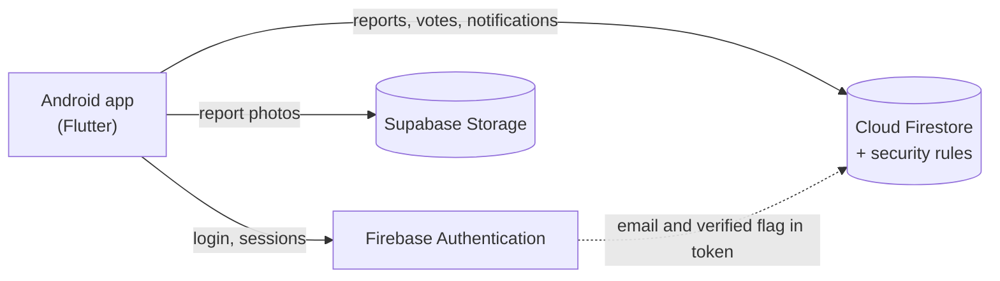
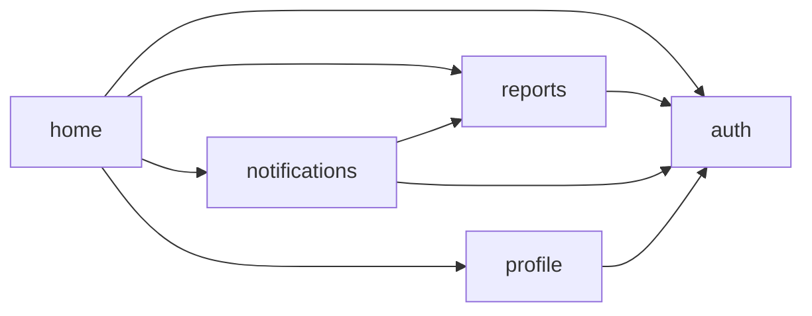
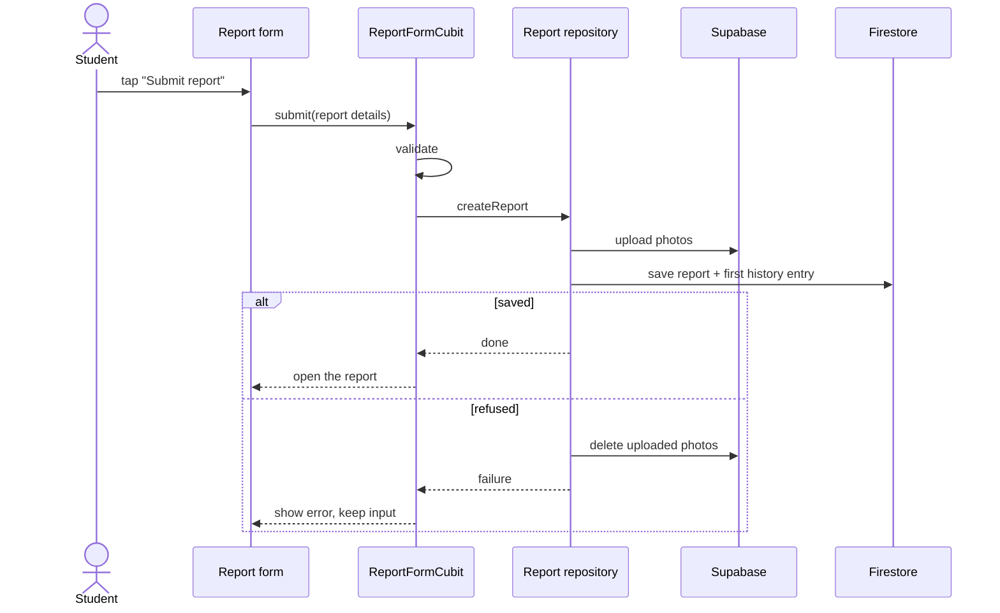
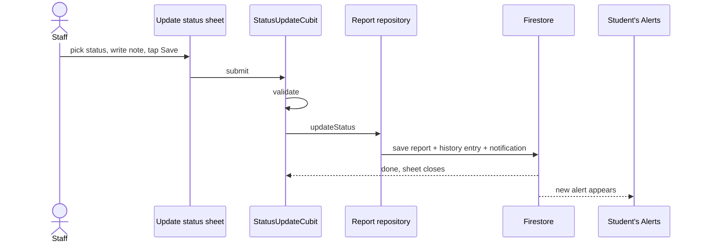
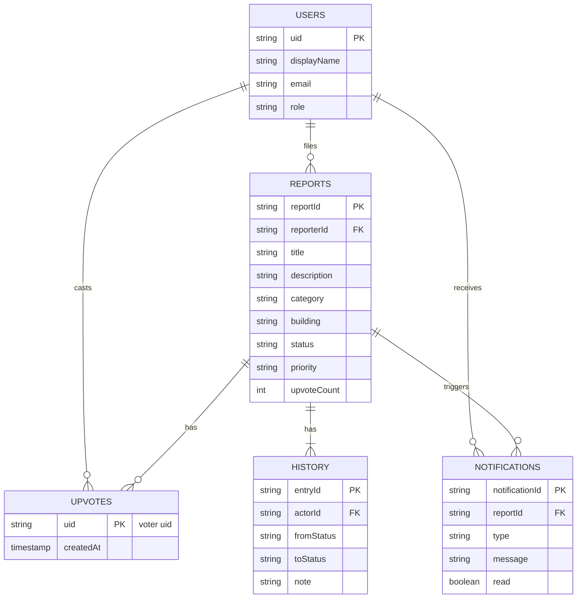
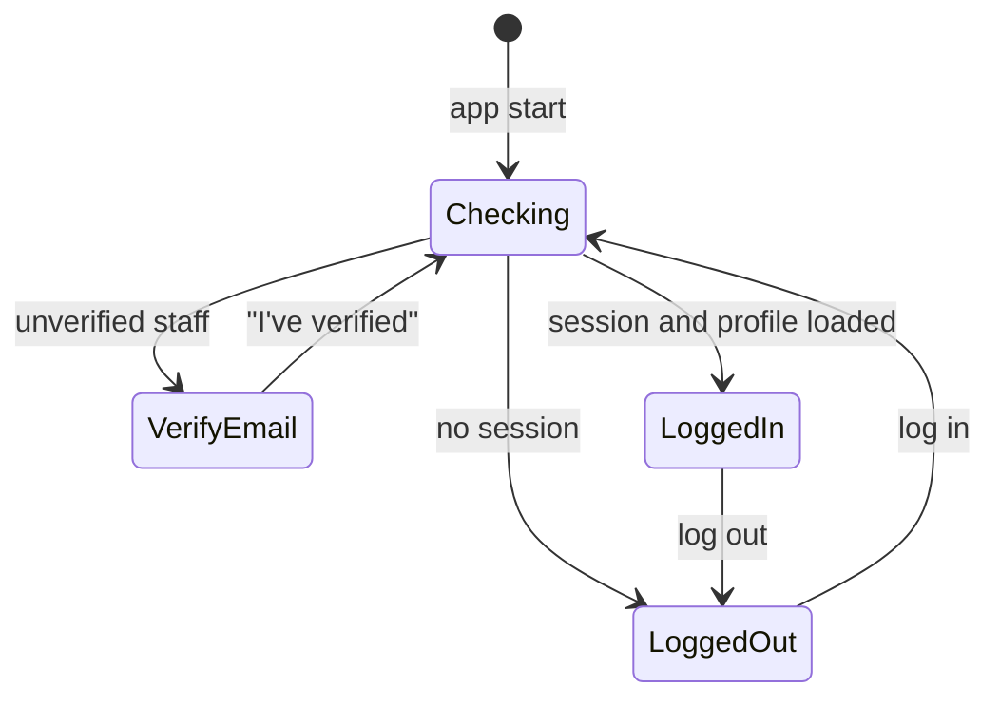

# Hero Technical Document

Hero is a Flutter (Android only) app where ALU students report campus problems and campus staff
triage them through to resolution.

---

## 1. Overview

Hero has two kinds of users: students and staff.

### Students

Identified by an `@alustudent.com` email.

Students report campus problems and follow them until they are resolved. A student can:

- Register, log in and reset their password
- File a report with up to 5 photos
- Browse, search, filter and sort all reports
- Edit or delete their own report, only while it is Submitted
- Vote "me too" on someone else's report
- See the status history of a report
- Receive in-app notifications when a status changes
- Change their display name

### Staff

Identified by an `@alueducation.com` email.

Staff review reports and move them through to resolution. A staff member can:

- Log in (staff accounts are created by an admin, not through the app)
- Browse, search, filter and sort all reports
- Change a report's status and priority, with a note
- See the status history of a report
- See status counts and the "Needs action" list

## 2. Technology stack

| Concern           | Choice                              | Notes                                                     |
|-------------------|-------------------------------------|-----------------------------------------------------------|
| Framework         | Flutter / Dart, Android             | Material 3, Pixel 8 emulator                              |
| State management  | `flutter_bloc` (Cubit), `equatable` | One Cubit per screen or feature, sealed states            |
| Identity          | `firebase_auth`                     | Email and password only                                   |
| Database          | `cloud_firestore`                   | Native mode, `(default)` database                         |
| Photo storage     | `supabase_flutter`                  | Used instead of Firebase Storage, which is not free       |
| Formatting, fonts | `intl`, `google_fonts` (DM Sans)    | Relative and absolute dates                               |

## 3. System architecture



Two backends, split on purpose:

| Backend          | Used for                                      | Why                                                     |
|------------------|-----------------------------------------------|---------------------------------------------------------|
| Firebase Auth    | Identity, email verification, password reset  | Assignment requirement                                  |
| Cloud Firestore  | Users, reports, history, votes, notifications | Assignment requirement; live streams; rules as the gate |
| Supabase Storage | Report photos only                            | Firebase Storage needs the paid plan                    |

There are no Cloud Functions. Counters, history and notifications are kept consistent by batched
writes that the security rules validate with `getAfter()` and `existsAfter()`.

## 4. Project structure

Feature-first. Each feature has its own `domain`, `application`, `data` and `presentation` folders
and one barrel file that is its public API.

```
.
├── lib/
│   ├── main.dart                  Initialisation only: dotenv, Firebase, Supabase, wiring
│   ├── app.dart                   Composition root: repository providers, MaterialApp, AuthGate
│   ├── firebase_options.dart      Generated by FlutterFire
│   ├── core/
│   │   ├── constants.dart         Email domains
│   │   ├── env.dart               Typed access to .env (fails fast when a key is missing)
│   │   └── theme/                 Colors, spacing, radii, ThemeData
│   ├── shared/
│   │   └── widgets/               Generic widgets: AppButton, AppTextField, ErrorView, ...
│   └── features/
│       ├── auth/                  Register, verify, login, reset, session, role, rename, account switching
│       ├── reports/               Reports, photos, history, votes, status updates
│       ├── notifications/         Student alerts and the unread badge
│       ├── profile/               Profile screen and display name change
│       └── home/                  Role-based bottom navigation shell
├── test/                          Mirrors lib/
├── scripts/
│   ├── seed-staff.js              Creates a staff user's verified flag and users/{uid} document
│   └── rules-tests/               Firestore rules tests on the emulator
├── firestore.rules                Complete security rules
└── firestore.indexes.json         The 23 composite indexes
```

## 5. Layering and dependency rules

Dependencies point inward: `presentation → application → domain`, and `data → domain`.

| Layer          | Contains                                                          | May import                        | Rules                                                                  |
|----------------|-------------------------------------------------------------------|-----------------------------------|------------------------------------------------------------------------|
| `domain`       | Entities, enums, validators, business rules, repository contracts | Dart core only                    | Imports no Flutter and no SDK                                          |
| `application`  | Cubits and their states                                           | `domain`                          | Imports no SDK and no `package:flutter/material.dart`                  |
| `data`         | Repository implementations, mappers, SDK adapters                 | `domain`, Firebase, Supabase      | Only layer that touches Firebase and Supabase                          |
| `presentation` | Screens and widgets                                               | `application`, `domain`, `shared` | Never imports `cloud_firestore`, `firebase_auth` or `supabase_flutter` |

Each layer's rules, and the rule below, are checked by `test/architecture_test.dart`:

- A feature reaches another feature only through its barrel file (`reports.dart`, `auth.dart`, ...).

Feature dependencies (arrows read "imports the barrel of"):



`reports` never imports `notifications`. Staff updates write the notification document themselves
(W5), so the dependency only runs one way. The `type` key is duplicated as `ChangeKind` in
`reports` and `NotificationType` in `notifications`; it is a wire-format string, covered by tests.

Two small contracts exist because of these rules:

- `PhotoUrlResolver` is a read-only lookup (`urlFor(path)`). Widgets use it to display photos
  without importing a repository. `PhotoStorage` extends it.
- Domain types never carry Firestore types. `Timestamp` and `FieldValue` stop in
  `data/*_mapper.dart`.

## 6. State management

### 6.1 Principles

- A **screen** reads Cubit state and calls Cubit methods. A **Cubit** calls repositories and turns
  failures into states. A **repository** is the only thing that talks to a backend.
- States are `sealed` and extend `Equatable`. A form uses one state class with a status enum, not
  separate `isLoading` / `data` / `error` booleans.
- Lists show loading, loaded, empty and error. Submit buttons are disabled while a request runs.
- Cubits never touch `BuildContext` and never call each other. Navigation and snackbars happen in
  `BlocListener`, and shared data flows through repositories.
- Cubits cancel their stream subscriptions in `close()` and check `isClosed` before emitting after
  an `await`.

### 6.2 Cubit inventory

| Cubit                 | Feature       | Scope (where it is created)     | State                                                                        | Source                              |
|-----------------------|---------------|---------------------------------|------------------------------------------------------------------------------|-------------------------------------|
| `AuthCubit`           | auth          | App root                        | Checking, Unauthenticated, EmailUnverified, Authenticated, AuthProfileFailed | Auth session stream + `users/{uid}` |
| `AuthFormCubit`       | auth          | Each auth screen                | Idle, Submitting, Failed, Succeeded                                          | One-off auth calls                  |
| `AccountsCubit`       | auth          | Accounts screen, switch link    | Loading, Loaded, Failed                                                      | `AccountSessions`                   |
| `ReportsCubit`        | reports       | Each list tab (one per tab)     | Loading, Loaded, Empty, Failure                                              | `watchReports(query, limit)`        |
| `ReportDetailCubit`   | reports       | Details screen                  | Loading, Loaded, Deleting, DeleteFailed, Deleted, Missing, Failure           | `watchReport(id)`                   |
| `ReportHistoryCubit`  | reports       | Details screen                  | Loading, Loaded, Failure                                                     | `watchHistory(id)`                  |
| `VoteCubit`           | reports       | Vote button (eligible students) | `VoteState` with `VoteStatus` enum                                           | `watchHasVoted` + vote writes       |
| `StatusUpdateCubit`   | reports       | Update status sheet (staff)     | `StatusUpdateState` with enum                                                | `updateStatus` (W5)                 |
| `StatusCountsCubit`   | reports       | Staff header                    | Loading, Loaded, Failure                                                     | `countByStatus()` aggregate         |
| `ReportFormCubit`     | reports       | Report form (create and edit)   | `ReportFormState` with `ReportFormStatus` enum                               | Photo picker + create / update      |
| `SimilarReportsCubit` | reports       | Report form (create only)       | Matching open reports                                                        | `findOpenIn(category, building)`    |
| `NotificationsCubit`  | notifications | Student shell                   | Loading, Loaded, Empty, Failed                                               | `watchLatest(uid, 50)`              |
| `ProfileCubit`        | profile       | Profile screen                  | Idle, Saving, Renamed, Failed                                                | `rename` (W8)                       |

### 6.3 Flow: a student files a report



### 6.4 Flow: staff change a status



## 7. Data model in the app

| Collection    | Firestore path                         |
|---------------|----------------------------------------|
| Users         | `users/{uid}`                          |
| Reports       | `reports/{reportId}`                   |
| History       | `reports/{reportId}/history/{entryId}` |
| Upvotes       | `reports/{reportId}/upvotes/{uid}`     |
| Notifications | `users/{uid}/notifications/{id}`       |



## 8. Queries, filters and indexes

A list screen holds one `ReportQuery`: status, category, date range, title search and sort, plus
two fixed scopes (`reporterId` for My reports, `restrictToStatuses` for Needs action).

- Equality filters (status, category, reporter) always run on the server.
- Firestore cannot run every combination, so the domain decides what runs where. A date range with
  a vote sort, or with a title search, is applied on the device after the query.
- Title search is a case-insensitive prefix match on the lowercased title.
- Lists load 20 reports at a time and stay live. "Load more" raises the limit.
- Status counts use `count()` aggregate queries instead of reading documents.
- A new query combination needs a new composite index in `firestore.indexes.json`.

## 9. Security

The UI hides what a role may not do, but the Firestore rules are the real gate.

### 9.1 Layers of defence

- **Form validators and domain guards** give immediate feedback and run again before each write.
  They are for UX only.
- **Firestore rules** enforce identity, role, field shape and allowed changes.
- **Supabase policies** limit photo uploads to the `reportPhotos/` prefix, JPEG, 5 MB. They cannot
  see who the user is (9.4).

### 9.2 What the rules enforce

- Every request needs a token email on `@alustudent.com` or a verified `@alueducation.com`. The
  role comes only from `users/{uid}.role`.
- Documents must have exactly the expected fields, types and lengths, and timestamps must be set by
  the server.
- A student creates reports and edits or deletes their own while Submitted. Staff change only status
  and priority, and every change must come with a history entry and a notification.
- Votes move the counter by exactly one together with the vote document, never on your own report.
- History is append-only. A notification can only be marked read by its recipient.

### 9.3 Authentication



### 9.4 Photos and Supabase

The Supabase anon key is public by design and cannot see Firebase Auth or Firestore. So
"owner only, only while Submitted" for photos is checked in the app (in the repository, before
upload and delete) and not by Supabase. A modified client could therefore write into the bucket
under `reportPhotos/`, but it could not attach those files to anyone else's report, because
`photoPaths` lives in Firestore under the rules above. Accepted limitation.

### 9.5 Secrets

`.env` is gitignored and holds only public-by-design values (Supabase URL and publishable key,
bucket name). Firebase client identifiers come from the generated `firebase_options.dart`. No
service account, admin token or service-role key is in the app or the repository.
`scripts/seed-staff.js` uses the developer's own `firebase login` and prints no tokens.

## 10. Photo pipeline

Photos are picked from the camera or gallery, re-encoded as JPEG (longest side 1600 px, at most
5 MB), uploaded to Supabase and shown from the stored path. A report holds at most 5 photos. File
names are generated, never taken from user input, and a photo that fails to load shows a
placeholder.

## 11. Error handling and resilience

- Adapters turn SDK errors into a few small failure types, so nothing above `data` sees an SDK
  exception.
- Screens show a short message for each failure (no connection, report changed or removed, unknown).
  Messages never include paths, ids or SDK text.
- A `permission-denied` is usually a lost race, such as a status moved or a report deleted, not a
  crash.
- Every repository call times out after 30 seconds.
- A broken photo or a failed history load affects only that part of the screen, which shows its own
  retry.
- Votes use a counter increment in one batch, and a stale staff update fails instead of
  overwriting.

## 12. Validation

Each rule is a pure function in `domain`. The form uses it, the Cubit checks it again before the
repository call, and the Firestore rules mirror it.

- **Email:** `@alustudent.com` to register, student or staff domain to log in.
- **Password:** 8+ characters with a letter and a number.
- **Display name:** 2 to 50 characters.
- **Report:** title 5 to 80, description 10 to 1000, category and building required, room up to 40,
  at most 5 photos.
- **Staff update:** a note of 3 to 300 characters, and a status or priority must change.

A failed submit keeps everything the user typed.

## 13. UI

## 14. Testing

- **Domain:** validators, permission checks, query logic.
- **Mappers:** exact key sets and strict parsing.
- **Cubits:** loading, loaded, empty and error states, double submits, race and failure paths.
- **Widgets:** login, register and report form validation and error display.
- **Architecture:** the import rules from section 5.
- **Security rules:** run against the Firestore emulator.

Tests use hand-written fakes of the repository contracts, with no real network.

## 15. References

[1] Flutter, "Flutter documentation." [Online]. Available: https://docs.flutter.dev/

[2] Google, "Cloud Firestore." [Online]. Available: https://firebase.google.com/docs/firestore

[3] Google, "Firebase Security Rules for Cloud Firestore." [Online]. Available:
https://firebase.google.com/docs/firestore/security/get-started

[4] Google, "Firebase Authentication." [Online]. Available: https://firebase.google.com/docs/auth

[5] Google, "Unit test your Security Rules with the Firebase Emulator Suite." [Online]. Available:
https://firebase.google.com/docs/rules/unit-tests

[6] Supabase, "Storage." [Online]. Available: https://supabase.com/docs/guides/storage

[7] Bloc, "Bloc library documentation." [Online]. Available: https://bloclibrary.dev/

[8] Dart, "Effective Dart." [Online]. Available: https://dart.dev/effective-dart

Add the access date to each reference before submitting (IEEE: "Accessed: Mon. DD, YYYY.").
